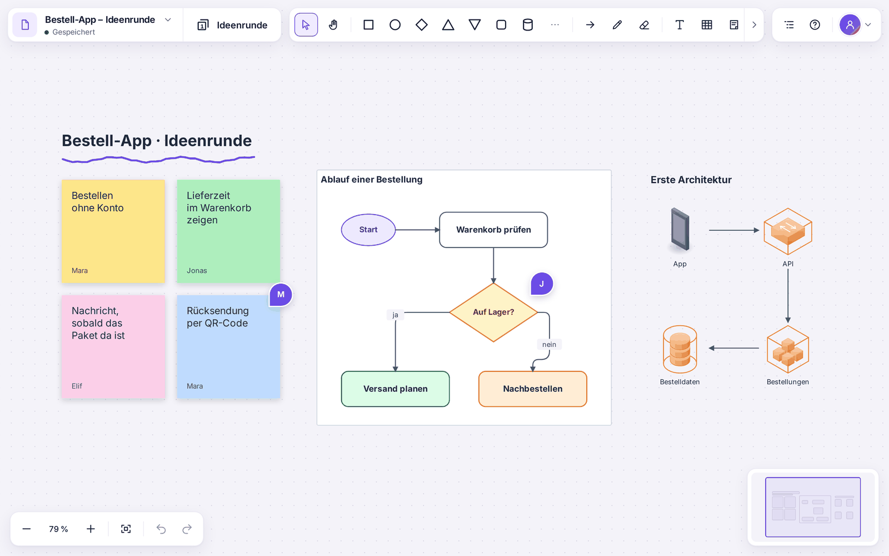
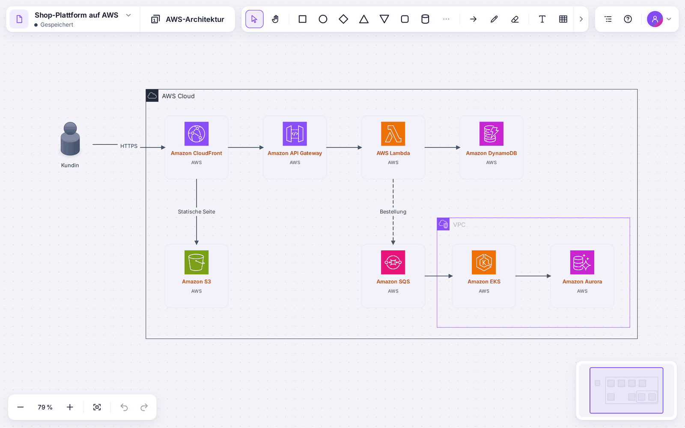
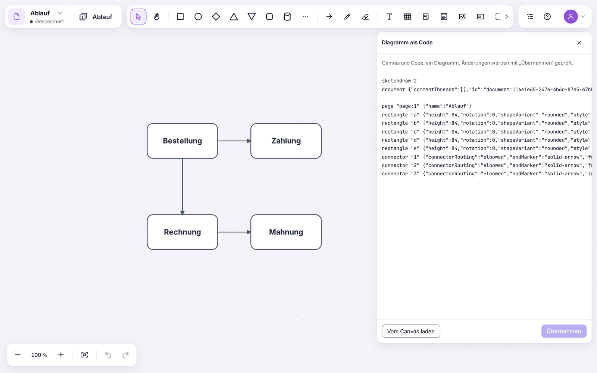
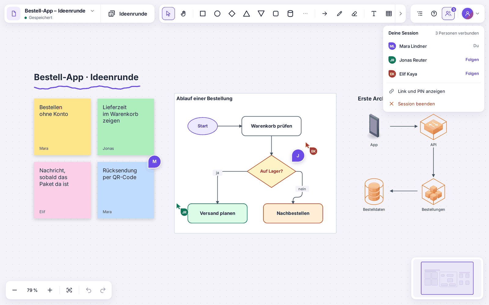
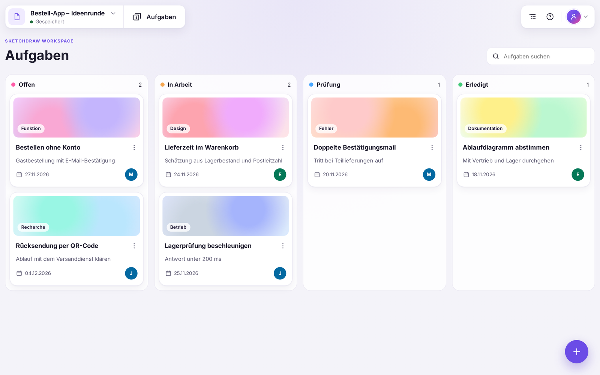
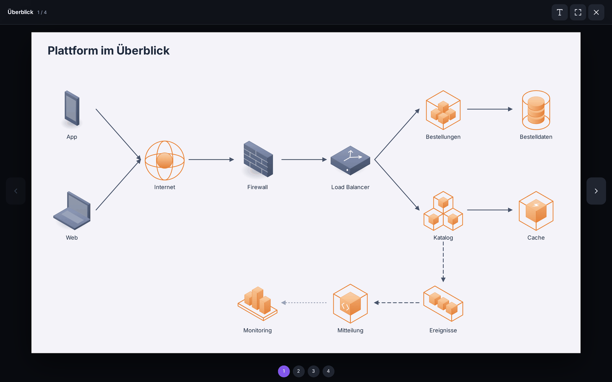

# Sketchdraw

**Sketchdraw ist ein offener Visual Workspace für Windows, macOS und Linux:** Whiteboard, Architektur- und Cloud-Diagramme, Diagram as Code, Zusammenarbeit ohne Server und ein MCP-Zugang für KI-Agenten. Menschen und Agenten bearbeiten dasselbe Diagramm – auf der Zeichenfläche oder als lesbaren Quelltext.

> Everything you can draw, an agent can understand. Everything an agent can create, a human can edit.

*Sketchdraw is an open desktop whiteboard and diagramming app (Electron, Vue 3, TypeScript): architecture and cloud diagrams for AWS, Azure, GCP and Kubernetes, sequence, BPMN and ER diagrams, Mermaid and diagram as code, serverless peer-to-peer collaboration and an MCP server for AI agents such as Claude Code and Codex.*



**Inhalt:** [Download](#download) · [Funktionen](#funktionen) · [Lizenz](#lizenz) · [Entwicklung](#entwicklung) · [Dokumentation](#dokumentation)

## Download

Das zuletzt veröffentlichte Release ist [v0.1.4](https://github.com/J-ARTS/de.sketchdraw.io/releases/tag/v0.1.4) mit drei nativ geprüften Installern:

- [Windows x64 – Installer](https://github.com/J-ARTS/de.sketchdraw.io/releases/download/v0.1.4/Sketchdraw-0.1.4-windows-x64.exe)
- [macOS Apple Silicon / M1 – DMG](https://github.com/J-ARTS/de.sketchdraw.io/releases/download/v0.1.4/Sketchdraw-0.1.4-macos-arm64.dmg)
- [Linux Debian/Ubuntu x64 – DEB](https://github.com/J-ARTS/de.sketchdraw.io/releases/download/v0.1.4/Sketchdraw-0.1.4-linux-x64.deb)

Windows ist unsigniert; die macOS-App ist ad-hoc-signiert und nicht notarisiert. Hinweise zum ersten Start und die konkreten nativen Prüfungen stehen in den Release-Notes und im [Release-Ablauf](docs/release.md).

Die Bilder unten zeigen den Stand von `main`. Er ist weiter als v0.1.4: Die Bibliotheken für ER-, BPMN- und Sequenzdiagramme, der Mermaid-Code, die isometrischen und die Lucide-Icons, der Git-Dialog, die Teilnehmerliste mit Mauszeigern und die Hilfslinien kommen mit dem nächsten Release. Bis dahin lässt sich der aktuelle Stand [aus dem Quelltext starten](#entwicklung).

## Funktionen

### Whiteboard

Eine unbegrenzte Zeichenfläche mit Formen, Freihandstift, Text, Haftnotizen, Tabellen, Bildern, Containern und Verbindern, die an ihren Elementen hängen bleiben. Ein Dokument hat beliebig viele Seiten; Rückgängig und Wiederholen gelten für die eigenen Schritte, und ungespeicherte Arbeit wird lokal gesichert und nach einem Neustart wiederhergestellt. Das Bild oben zeigt eine solche Seite.

### Hilfslinien beim Verschieben

Beim Verschieben rastet ein Element an den Kanten und der Mitte des nächstgelegenen Elements ein. Gleiche Abstände in einer Reihe werden gefunden und mit ihrem Maß angezeigt. Mit gedrückter Strg- bzw. Cmd-Taste bewegt sich das Element frei; in den Einstellungen lässt sich die Hilfe abschalten.


### Formenbibliothek mit den Icons der Cloud-Anbieter

Die Bibliothek enthält Grundformen, Flussdiagramm-Symbole und die offiziellen Architektur-Icons von AWS (784), Azure (713), Google Cloud (235) und Kubernetes (39). Eine Suche geht über alle Bibliotheken. Lieblingsformen lassen sich in die obere Leiste legen, und eine Auswahl auf der Zeichenfläche wird auf Wunsch zur eigenen Komponente.


### Architektur- und Cloud-Diagramme

Cloud-Dienste stehen als Karten mit Icon, Name und Anbieter auf der Zeichenfläche. Für AWS gibt es die Gruppenrahmen der Referenzarchitekturen – Cloud, Region, VPC, Subnetze und weitere. Die Ressourcenkarte unter „Azure Diagrams" nimmt Titel, Beschreibung und ein Icon aus einer beliebigen Bibliothek auf.



### Isometrische Icons

29 isometrische Symbole für IT-Bausteine – Dienste, Daten, Server, Netz und Clients. Sie stehen frei auf der Zeichenfläche und tragen ihre Beschriftung darunter.


### Lucide-Icons

Die 2091 Linien-Icons von [Lucide](https://lucide.dev) in 41 Kategorien. Ein Icon übernimmt die Linienfarbe seines Elements und passt damit in jedes Diagramm.


### Sequenzdiagramme mit Mermaid-Code

Sequenzdiagramme ordnen sich selbst: Aktivierungen, Nummern und Abstände folgen aus den Nachrichten. Der Mermaid-Code steht daneben. Was im Code getippt wird, erscheint sofort im Diagramm, und jede Änderung im Diagramm steht sofort im Code.


### Abläufe mit BPMN

Ereignisse, Aufgaben, Gateways, Pools und Bahnen. Auch ein Ablauf lässt sich als Mermaid-Code schreiben; Pools und Bahnen sind dort `subgraph`-Blöcke.


### ER-Diagramme

Entitäten sind Tabellen, Beziehungen tragen Krähenfuß-Enden für 1:1, 1:n und n:m. Für die Chen-Notation gibt es eigene Formen.


### Diagramm als Code

Jedes Dokument hat einen lesbaren Text mit einem Element pro Zeile, damit ein Diff in Git zeigt, was sich geändert hat. Änderungen am Text werden geprüft und erst mit „Übernehmen" auf die Zeichenfläche gebracht; ein ungültiger Entwurf bleibt als Entwurf erhalten.



### Zusammenarbeiten ohne Server

Eine Session verbindet Desktop-Apps direkt miteinander: ein `sketchdraw://`-Link und eine getrennt geteilte PIN genügen. Alle sehen, wer dabei ist und wo die anderen gerade zeigen. Der Gastgeber vergibt Lese- oder Schreibrecht, kann jemanden entfernen und die Session beenden. Wer die Verbindung verliert, hat fünf Minuten, um zurückzukommen.


Solange eine Session läuft, steht ihr Symbol in der oberen Leiste. Von dort folgt man einer Person – die eigene Ansicht geht dann mit ihrer mit – oder beendet die Session.



Dokumente werden lokal gespeichert. Sessions brauchen keinen festen Server und kein Gateway; die Inhalte sind Ende-zu-Ende verschlüsselt. Die Geräte verbinden sich über HyperDHT direkt, sonst über freiwillige Relay-Helfer: Solange eine Session läuft, leitet die App mit begrenzter Bandbreite auch verschlüsselte Daten anderer Sessions weiter. Eine Verbindung ist nicht in jedem Netzwerk möglich: Ist UDP vollständig gesperrt, kommt keine zustande. Details stehen in [ADR 0007](docs/decisions/0007-app-link-and-session-relay-helper.md).

### Kommentare und Aufgaben

Ein Kommentar hängt an einem Element, einer Tabellenzelle oder einer freien Stelle. Antworten bilden einen Thread, der sich als erledigt markieren lässt.


Aus Kommentaren und Haftnotizen werden Aufgaben. Das Board gehört zum Dokument und zeigt sie mit Art, Fälligkeit und zuständiger Person in vier Spalten. Mit dem Atlassian-Plugin werden Aufgaben zu Jira-Tickets.



### Folien und Präsentieren

Ein Frame macht einen Ausschnitt der Zeichenfläche zur Folie. Die Folienleiste ordnet die Folien und nimmt Notizen auf.


Präsentiert wird mit der Tastatur, auf Wunsch im Vollbild; die Presenter-Ansicht zeigt zusätzlich die Notizen.



### Git

Mit dem Git-Plugin liegt das Diagramm in einem Repository. Der Git-Dialog zeigt Änderungen und ihren Diff, committet ausgewählte Dateien, pusht, holt den Remote-Stand und setzt das Diagramm auf einen alten Commit zurück. Auto-Commit, Auto-Push und Auto-Sync lassen sich einzeln schalten.


### Import und Export

Austausch mit draw.io, SVG und Mermaid. Vor jeder Umwandlung zeigt eine Vorschau, was dabei verloren geht oder nur angenähert wird; erst nach der Bestätigung entsteht die Datei. Auf Wunsch wird das Dokument in die Datei eingebettet; ein unveränderter eigener Export lässt sich dann vollständig zurücklesen.


### KI-Agenten über MCP

Die Desktop-App stellt das geöffnete lokale Dokument automatisch als MCP-Server bereit – ohne Freigabedialog. Ein einmal eingerichteter Client wie Claude Code, Codex oder Antigravity liest das Diagramm, durchsucht und analysiert es und ändert es gezielt:

| Werkzeug | Zweck |
| --- | --- |
| `sketchdraw_read_document` | Dokument und Revision lesen |
| `sketchdraw_find_elements` | Elemente nach ID, Art, Text oder Metadaten suchen |
| `sketchdraw_analyze_document` | Struktur prüfen, z. B. ungebundene Verbindungen |
| `sketchdraw_read_code` | Diagrammcode lesen |
| `sketchdraw_apply_commands` | einzelne Änderungen anwenden |
| `sketchdraw_apply_code` | den ganzen Diagrammcode ersetzen |

Eine Agentenänderung erscheint sofort auf der Zeichenfläche und wird nicht automatisch auf die Festplatte gespeichert. Die Einrichtung steht in [MCP verbinden und verwenden](docs/agent-integration.md).

### Hell, dunkel, Deutsch und Englisch

Die Oberfläche gibt es hell und dunkel sowie auf Deutsch und Englisch. Der Hintergrund der Zeichenfläche ist wählbar und gilt nur für die eigene Ansicht.


### Confluence und Jira

Das Atlassian-Plugin bindet Confluence-Seiten als Live Docs in das Dokument ein und legt Aufgaben und Kommentare als Jira-Tickets an. Das automatische Aktualisieren des Diagramms auf einer Confluence-Seite ist umgesetzt und noch in Prüfung ([#210](https://github.com/J-ARTS/de.sketchdraw.io/issues/210)). Das Zugangstoken liegt verschlüsselt im Profil auf dem Gerät und gelangt weder in Diagramme noch in Git.

## Lizenz

Sketchdraw steht unter der **PolyForm Noncommercial License 1.0.0**, soweit einzelne Bestandteile nicht anders gekennzeichnet sind. Nutzung, Änderungen und Weitergabe sind für die im [Lizenztext](LICENSE) erlaubten Zwecke möglich. Für darüber hinausgehende kommerzielle Nutzung ist eine gesonderte Erlaubnis der Rechteinhaber erforderlich.

Die [Lizenz-README](docs/licensing/README.md) erklärt die Bedingungen und den Auslieferungsstand. Direkte Kollaborationsabhängigkeiten stehen in den [Drittanbieter-Hinweisen](THIRD_PARTY_NOTICES.md); die Lizenzen der verwendeten Bibliotheken und Schriften bleiben erhalten.

## Entwicklung

Voraussetzungen und Plattformdetails stehen in [docs/setup.md](docs/setup.md). Der verwendete Stack ist Electron, Vue 3 und TypeScript; Abhängigkeiten sind über das Lockfile festgelegt.

```sh
npm ci
npm run build:mcp
npm run dev:electron
```

Für die Browservorschau: `npm run dev:browser`. Der lokale MCP-Zugriff benötigt die Desktop-App.

```sh
npm run typecheck
npm run test:unit
node --test tests/unit/*.test.mjs
npx playwright install chromium
npm run test:ui
npm run test:electron
```

## Dokumentation

- [MCP verbinden und verwenden](docs/agent-integration.md)
- [Installer und Releaseprüfungen](docs/release.md)
- [Architektur](docs/architecture.md), [Sprints](docs/sprints.md) und [geprüfte Bedenken](docs/concerns.md)
- [GitHub-Tickets](https://github.com/J-ARTS/de.sketchdraw.io/issues) als dauerhafte Statusquelle
- [Graphify und Aufwandserfassung](docs/graphify-traceability.md)

Das Zielbild und die verbindliche Zusammenarbeit stehen in [AGENTS.md](AGENTS.md) und [CLAUDE.md](CLAUDE.md). Einzelne Testberichte gelten jeweils für den dort genannten Stand; offene Prüfungen sind kein bestandener Release.
