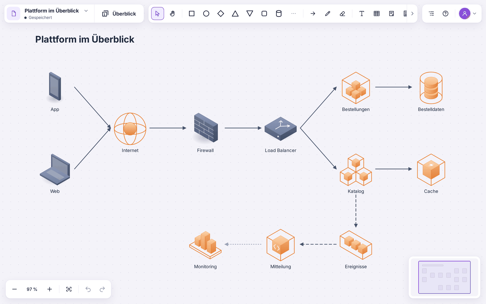
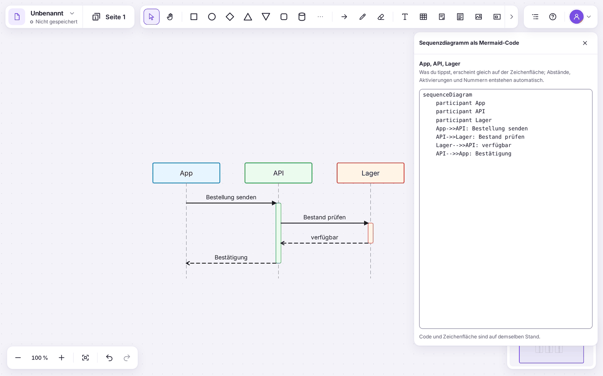
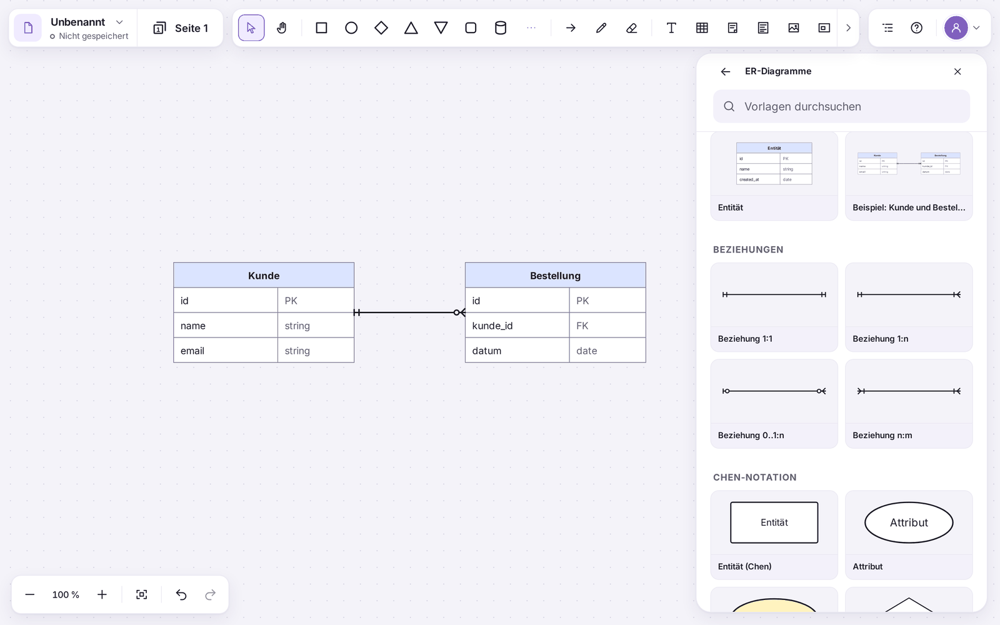
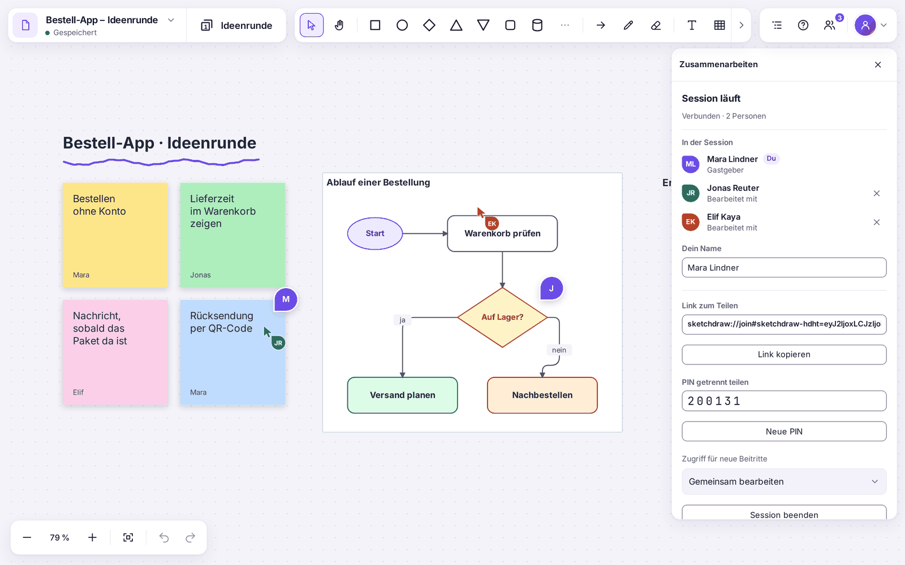
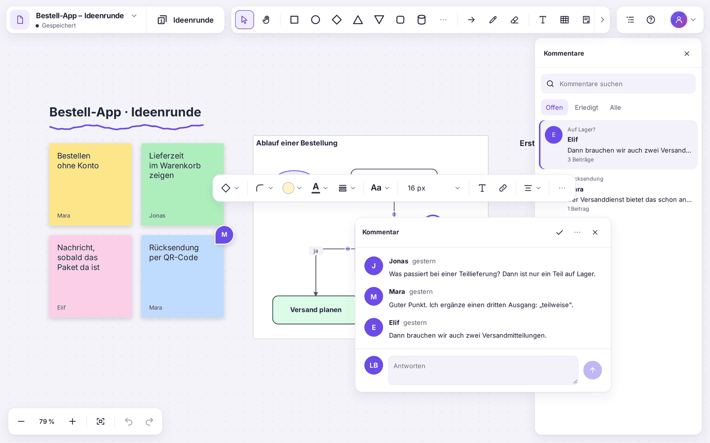
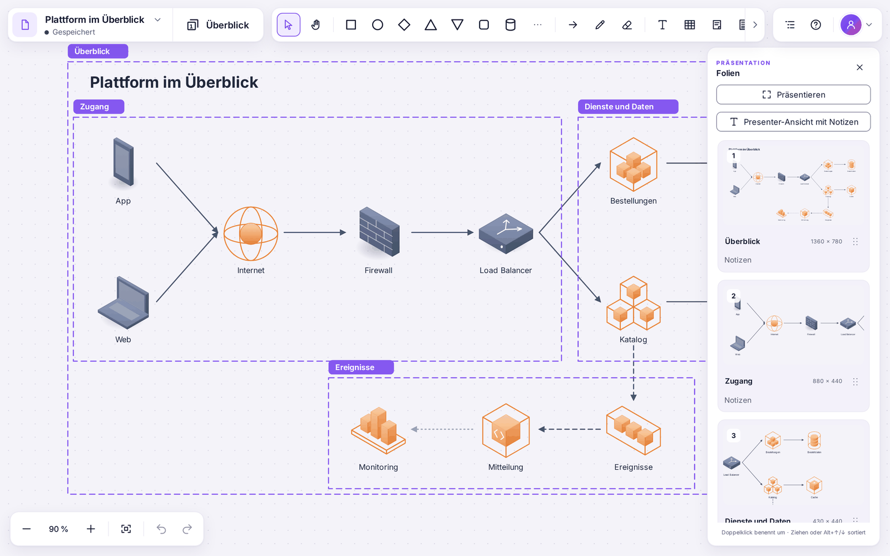
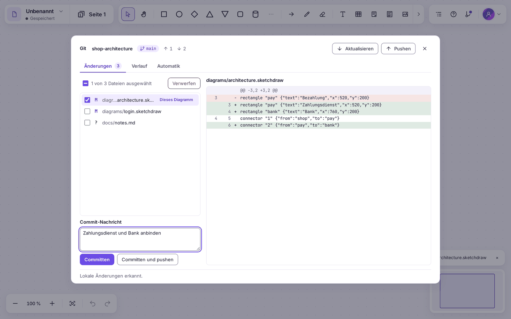
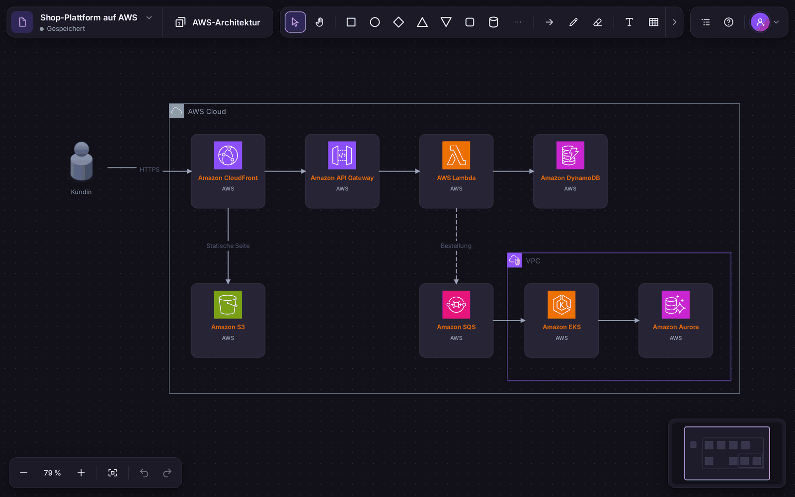

# Sketchdraw

**Sketchdraw is an open visual workspace for Windows, macOS and Linux:** a whiteboard, architecture and cloud diagrams, diagram as code, collaboration without a server and MCP access for AI agents. People and agents work on the same diagram – on the canvas or as readable source text.

> Everything you can draw, an agent can understand. Everything an agent can create, a human can edit.

*Sketchdraw is a desktop whiteboard and diagramming app (Electron, Vue 3, TypeScript): architecture and cloud diagrams for AWS, Azure, GCP and Kubernetes, sequence, BPMN and ER diagrams, Mermaid and diagram as code, serverless peer-to-peer collaboration and an MCP server for AI agents such as Claude Code and Codex.*

[](docs/video/sketchdraw-film.mp4)

[Watch the film](docs/video/sketchdraw-film.mp4) – 65 seconds: whiteboard, smart guides, cloud architecture, light and dark mode, isometric icons, Mermaid, diagram as code, MCP, collaboration, comments, tasks and presenting.


**Contents:** [Download](#download) · [Features](#features) · [License](#license) · [Development](#development) · [Documentation](#documentation)

The screenshots show the German interface; the app is available in German and English.

## Download

The latest published release is [v0.1.6](https://github.com/J-ARTS/de.sketchdraw.io/releases/tag/v0.1.6) with three natively verified installers:

- [Windows x64 – installer](https://github.com/J-ARTS/de.sketchdraw.io/releases/download/v0.1.6/Sketchdraw-0.1.6-windows-x64.exe)
- [macOS Apple Silicon / M1 – DMG](https://github.com/J-ARTS/de.sketchdraw.io/releases/download/v0.1.6/Sketchdraw-0.1.6-macos-arm64.dmg)
- [Linux Debian/Ubuntu x64 – DEB](https://github.com/J-ARTS/de.sketchdraw.io/releases/download/v0.1.6/Sketchdraw-0.1.6-linux-x64.deb)

The Windows installer is unsigned; the macOS app is ad-hoc signed and not notarized. Notes on the first start and the native checks that were run are in the release notes and in the [release process](docs/release.md).

The pictures below show this release. The current state of `main` can be [started from source](#development).

### Updates

From the release after v0.1.6 on, the installed app looks for a newer release itself: at start-up and every few hours it asks GitHub for the latest published release, and **Check for Updates…** (app menu on macOS, Help menu on Windows and Linux, and the settings) does the same on request. If there is a newer version, Sketchdraw asks before it does anything, then downloads the installer for your platform, compares its size and SHA-256 with the release and installs it: the Windows installer runs silently, the Debian package goes through the system prompt for administrator rights, and on macOS the app is replaced from the disk image once it has quit. Where an installation cannot replace itself – an unpacked copy, a read-only folder, an app started from the disk image – it points to the release page instead. The automatic check can be switched off in the settings; nothing from your documents is sent.

## Features

### Whiteboard

An infinite canvas with shapes, a freehand pen, text, sticky notes, tables, images, containers and connectors that stay attached to their elements. A document has any number of pages; undo and redo apply to your own steps, and unsaved work is kept locally and restored after a restart. The picture above shows such a page.

### Guides while moving

While it is moved, an element snaps to the edges and the centre of the nearest element. Equal distances in a row are found and shown with their measure. Holding Ctrl or Cmd moves the element freely; the guides can be switched off in the settings.


### Shape library with the cloud providers' icons

The library holds basic shapes, flowchart symbols and the official architecture icons of AWS (784), Azure (713), Google Cloud (235) and Kubernetes (39). One search covers all libraries. Favourite shapes can be placed in the top bar, and a selection on the canvas becomes a component of your own if you want.


### Architecture and cloud diagrams

Cloud services stand on the canvas as cards with icon, name and provider. For AWS there are the group frames of the reference architectures – cloud, region, VPC, subnets and more. The resource card under "Azure Diagrams" takes a title, a description and an icon from any library.


### Isometric icons

29 isometric symbols for IT building blocks – services, data, servers, network and clients. They stand freely on the canvas and carry their label below.



### Lucide icons

The 2091 line icons of [Lucide](https://lucide.dev) in 41 categories. An icon takes the stroke colour of its element and so fits into any diagram.


### Sequence diagrams with Mermaid code

Sequence diagrams arrange themselves: activations, numbers and distances follow from the messages. The Mermaid code stands beside the diagram. What is typed in the code appears in the diagram at once, and every change in the diagram is in the code at once.



### Processes with BPMN

Events, tasks, gateways, pools and lanes. A process can be written as Mermaid code too; pools and lanes are `subgraph` blocks there.


### ER diagrams

Entities are tables, relationships carry crow's foot ends for 1:1, 1:n and n:m. Chen notation has shapes of its own.



### Diagram as code

Every document has a readable text with one element per line, so that a diff in Git shows what has changed. Changes to the text are checked and only reach the canvas with "Apply"; an invalid draft is kept as a draft.


### Collaborating without a server

A session connects desktop apps directly with each other: a `sketchdraw://` link and a PIN shared separately are enough. Everyone sees who is there and where the others are pointing. The host grants read or write access, can remove someone and end the session. Whoever loses the connection has five minutes to come back.



While a session is running, its symbol is in the top bar. From there you follow a person – your own view then moves with theirs – or end the session.


Documents are stored locally. Sessions need neither a fixed server nor a gateway; the content is end-to-end encrypted. The devices connect directly over HyperDHT, otherwise through voluntary relay helpers: while a session is running, the app also forwards encrypted data of other sessions with limited bandwidth. A connection is not possible in every network: if UDP is blocked completely, none is established. Details are in [ADR 0007](docs/decisions/0007-app-link-and-session-relay-helper.md).

### Comments and tasks

A comment is attached to an element, a table cell or a free spot. Replies form a thread that can be marked as resolved.



Comments and sticky notes become tasks. The board belongs to the document and shows them with type, due date and assignee in four columns. With the Atlassian plugin, tasks become Jira tickets.


### Slides and presenting

A frame turns a section of the canvas into a slide. The slide bar orders the slides and takes notes.



Presenting works with the keyboard, in full screen if you want; the presenter view also shows the notes.


### Git

With the Git plugin, the diagram lives in a repository. The Git dialog shows changes and their diff, commits selected files, pushes, fetches the remote state and resets the diagram to an old commit. Auto-commit, auto-push and auto-sync can be switched individually.



### Import and export

Exchange with draw.io, SVG and Mermaid. Before every conversion, a preview shows what is lost or only approximated; the file is created only after confirmation. If you want, the document is embedded in the file; an unchanged export of your own can then be read back completely.


### AI agents over MCP

The desktop app provides the open local document as an MCP server automatically – without a sharing dialog. A client set up once, such as Claude Code, Codex or Antigravity, reads the diagram, searches and analyses it and changes it precisely:

| Tool | Purpose |
| --- | --- |
| `sketchdraw_read_document` | Read the document and its revision |
| `sketchdraw_find_elements` | Find elements by ID, kind, text or metadata |
| `sketchdraw_analyze_document` | Check the structure, e.g. unbound connections |
| `sketchdraw_read_code` | Read the diagram code |
| `sketchdraw_apply_commands` | Apply individual changes |
| `sketchdraw_apply_code` | Replace the whole diagram code |

A change made by an agent appears on the canvas at once and is not saved to disk automatically. The setup is described in [Connecting and using MCP](docs/agent-integration.md).

### Light, dark, German and English

The interface comes in light and dark and in German and English. The background of the canvas can be chosen and applies only to your own view.



### Confluence and Jira

The Atlassian plugin embeds Confluence pages in the document as Live Docs and creates tasks and comments as Jira tickets. Updating the diagram on a Confluence page automatically is implemented and still under review ([#210](https://github.com/J-ARTS/de.sketchdraw.io/issues/210)). The access token is stored encrypted in the profile on the device and reaches neither diagrams nor Git.

## License

Sketchdraw is licensed under the **PolyForm Noncommercial License 1.0.0**, unless individual parts are marked otherwise. Use, changes and distribution are possible for the purposes permitted in the [license text](LICENSE). Commercial use beyond that requires separate permission from the rights holders.

The [licensing README](docs/licensing/README.md) explains the terms and the delivery state. Direct collaboration dependencies are listed in the [third-party notices](THIRD_PARTY_NOTICES.md); the licenses of the libraries and fonts used are retained.

## Development

Requirements and platform details are in [docs/setup.md](docs/setup.md). The stack is Electron, Vue 3 and TypeScript; dependencies are pinned by the lockfile.

```sh
npm ci
npm run build:mcp
npm run dev:electron
```

For the browser preview: `npm run dev:browser`. Local MCP access needs the desktop app.

```sh
npm run typecheck
npm run test:unit
node --test tests/unit/*.test.mjs
npx playwright install chromium
npm run test:ui
npm run test:electron
```

## Documentation

The documents linked here are written in German.

- [Connecting and using MCP](docs/agent-integration.md)
- [Installers and release checks](docs/release.md)
- [Architecture](docs/architecture.md), [sprints](docs/sprints.md) and [reviewed concerns](docs/concerns.md)
- [GitHub issues](https://github.com/J-ARTS/de.sketchdraw.io/issues) as the permanent source of status
- [Graphify and effort tracking](docs/graphify-traceability.md)

The target picture and the binding rules of collaboration are in [AGENTS.md](AGENTS.md) and [CLAUDE.md](CLAUDE.md). Individual test reports apply to the state named in them; open checks are not a passed release.
