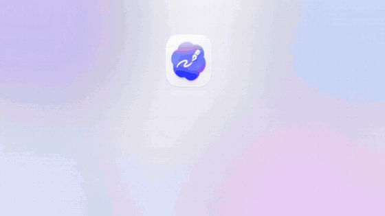
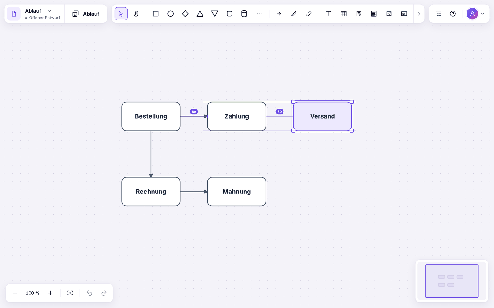
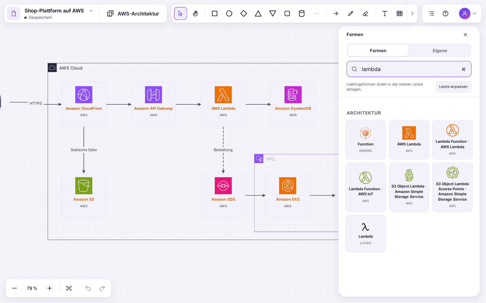
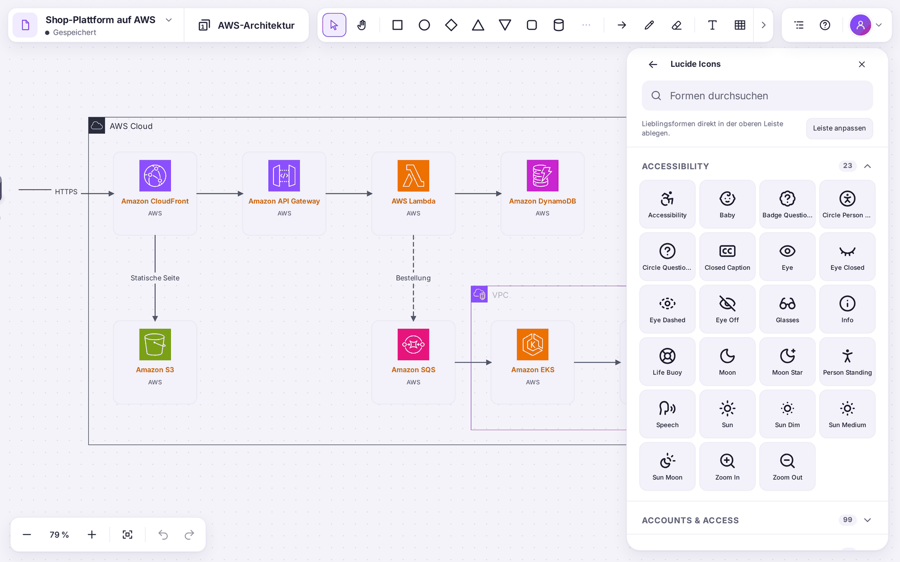
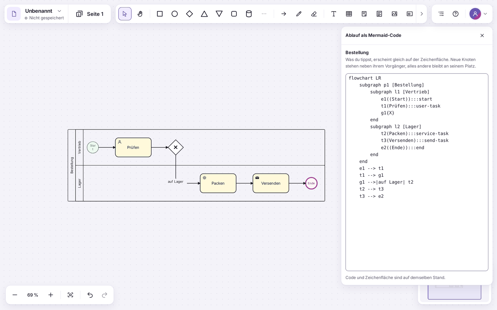
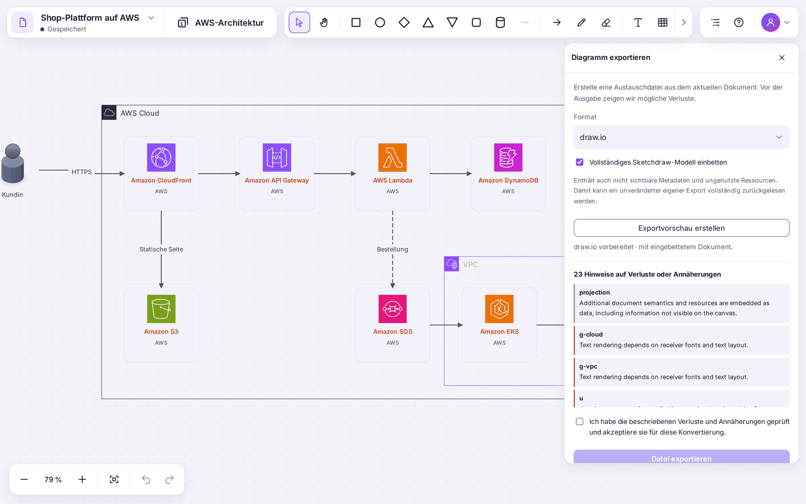

# Sketchdraw

**Sketchdraw is an open visual workspace for Windows, macOS and Linux:** a whiteboard, architecture and cloud diagrams, diagram as code, collaboration without a server and MCP access for AI agents. People and agents work on the same diagram – on the canvas or as readable source text.

> Everything you can draw, an agent can understand. Everything an agent can create, a human can edit.

*Sketchdraw is a desktop whiteboard and diagramming app (Electron, Vue 3, TypeScript): architecture and cloud diagrams for AWS, Azure, GCP and Kubernetes, sequence, BPMN and ER diagrams, Mermaid and diagram as code, serverless peer-to-peer collaboration and an MCP server for AI agents such as Claude Code and Codex.*

[](docs/video/sketchdraw-film.mp4)

[Watch the film](docs/video/sketchdraw-film.mp4) – 65 seconds: whiteboard, smart guides, cloud architecture, light and dark mode, isometric icons, Mermaid, diagram as code, MCP, collaboration, comments, tasks and presenting.


**Contents:** [Download](#download) · [Features](#features) · [License](#license) · [Development](#development) · [Documentation](#documentation)

The screenshots show the German interface; the app is available in German and English.

## Download

The latest published release is [v0.1.8](https://github.com/J-ARTS/de.sketchdraw.io/releases/tag/v0.1.8) with three natively verified installers:

- [Windows x64 – installer](https://github.com/J-ARTS/de.sketchdraw.io/releases/download/v0.1.8/Sketchdraw-0.1.8-windows-x64.exe)
- [macOS Apple Silicon / M1 – DMG](https://github.com/J-ARTS/de.sketchdraw.io/releases/download/v0.1.8/Sketchdraw-0.1.8-macos-arm64.dmg)
- [Linux Debian/Ubuntu x64 – DEB](https://github.com/J-ARTS/de.sketchdraw.io/releases/download/v0.1.8/Sketchdraw-0.1.8-linux-x64.deb)

The Windows installer is unsigned; the macOS app is ad-hoc signed and not notarized. Notes on the first start and the native checks that were run are in the release notes and in the [release process](docs/release.md).

The pictures below show this release. The current state of `main` can be [started from source](#development).

### Updates

From v0.1.8 on, the installed app looks for a newer release itself: at start-up and every few hours it asks GitHub for the latest published release, and **Check for Updates…** (app menu on macOS, Help menu on Windows and Linux, and the settings) does the same on request. If there is a newer version, Sketchdraw asks before it does anything, then downloads the installer for your platform, compares its size and SHA-256 with the release and installs it: the Windows installer runs silently, the Debian package goes through the system prompt for administrator rights, and on macOS the app is replaced from the disk image once it has quit. Where an installation cannot replace itself – an unpacked copy, a read-only folder, an app started from the disk image – it points to the release page instead. A copy started from the sources has the menu entry too: it compares its version with the latest release when you choose it and points to the release page, and it never looks on its own or installs anything. The automatic check can be switched off in the settings; nothing from your documents is sent.

## Features

### Whiteboard

An infinite canvas with shapes, a freehand pen, text, sticky notes, tables, images, containers and connectors that stay attached to their elements. A document has any number of pages; undo and redo apply to your own steps, and unsaved work is kept locally and restored after a restart. The picture above shows such a page.

### Guides while moving

While it is moved, an element snaps to the edges and the centre of the nearest element. Equal distances in a row are found and shown with their measure. Holding Ctrl or Cmd moves the element freely; the guides can be switched off in the settings.



### Shape library with the cloud providers' icons

The library holds basic shapes, flowchart symbols and the official architecture icons of AWS (784), Azure (713), Google Cloud (235) and Kubernetes (39). One search covers all libraries. Favourite shapes can be placed in the top bar, and a selection on the canvas becomes a component of your own if you want. Your own components can be exported to a file and imported on another device, under "…" in the "Mine" tab.



### Architecture and cloud diagrams

Cloud services stand on the canvas as cards with icon, name and provider. For AWS there are the group frames of the reference architectures – cloud, region, VPC, subnets and more. The resource card under "Cards" takes a title, a description and an icon from any library. Title and description can have several lines (Shift+Enter while typing on the canvas) and the card grows with them; besides the classic look there is one with a dashed frame and a bar that lists the links.


### Isometric icons

29 isometric symbols for IT building blocks – services, data, servers, network and clients. They stand freely on the canvas and carry their label below.


### Lucide icons

The 2091 line icons of [Lucide](https://lucide.dev) in 41 categories. An icon takes the stroke colour of its element and so fits into any diagram.



### Sequence diagrams with Mermaid code

Sequence diagrams arrange themselves: activations, numbers and distances follow from the messages. The Mermaid code stands beside the diagram. What is typed in the code appears in the diagram at once, and every change in the diagram is in the code at once. Ctrl+F (⌘F) searches the code and Ctrl+R (⌘R) replaces in it, with options for case, whole words and regular expressions.


### Processes with BPMN

Events, tasks, gateways, pools and lanes. A process can be written as Mermaid code too; pools and lanes are `subgraph` blocks there.



### ER diagrams

Entities are tables, relationships carry crow's foot ends for 1:1, 1:n and n:m. Chen notation has shapes of its own.


### Diagram as code

Every document has a readable text with one element per line, so that a diff in Git shows what has changed. Changes to the text are checked and only reach the canvas with "Apply"; an invalid draft is kept as a draft.


### Collaborating without a server

A session connects desktop apps directly with each other: a `sketchdraw://` link and a PIN shared separately are enough. Everyone sees who is there and where the others are pointing. The host grants read or write access, can remove someone and end the session. Whoever loses the connection has five minutes to come back.


While a session is running, its symbol is in the top bar. From there you follow a person – your own view then moves with theirs – or end the session.


Documents are stored locally, and the content of a session is end-to-end encrypted. Whoever starts a session chooses how the devices reach each other. **Direct (P2P)** is the default and needs neither a fixed server nor a gateway: the devices connect directly over HyperDHT, otherwise through voluntary relay helpers – while a session is running, the app also forwards encrypted data of other sessions with limited bandwidth. This route is not possible in every network: if UDP is blocked completely, no connection is established. **Cloudflare relay** is the route for those networks: every device opens a WebSocket to a relay that you run yourself as a Cloudflare Worker ([relay/cloudflare](relay/cloudflare/README.md)); the session link carries its address, so guests set nothing. The relay forwards only encrypted records and stores nothing; it sees network addresses, times and amounts of data, never the PIN or the drawing. No relay address ships with the app. Details are in [ADR 0007](docs/decisions/0007-app-link-and-session-relay-helper.md) and [ADR 0010](docs/decisions/0010-session-route-cloudflare-relay.md).

### Comments and tasks

A comment is attached to an element, a table cell or a free spot. Replies form a thread that can be marked as resolved.


Comments and sticky notes become tasks. The board belongs to the document and shows them with type, due date and assignee in four columns. With the Jira plugin, tasks become Jira tickets; with the Azure DevOps plugin, work items in Azure Boards.


### Slides and presenting

A frame turns a section of the canvas into a slide. The slide bar orders the slides and takes notes.


Presenting works with the keyboard, in full screen if you want; the presenter view also shows the notes.


### Git

With the Git plugin, the diagram lives in a repository. The Git dialog shows changes and their diff, commits selected files, pushes, fetches the remote state and resets the diagram to an old commit. Auto-commit, auto-push and auto-sync can be switched individually.


### Import and export

Exchange with draw.io, SVG and Mermaid. Before every conversion, a preview shows what is lost or only approximated; the file is created only after confirmation. If you want, the document is embedded in the file; an unchanged export of your own can then be read back completely. Mermaid code can be pasted or read from a `.mmd` file: flowcharts become shapes, and a `sequenceDiagram` becomes an editable sequence diagram. Every other kind of Mermaid diagram (class, state and ER diagrams, Gantt charts, mind maps and the rest of [mermaid.js.org](https://mermaid.js.org/syntax/all-examples.html)) is drawn by Mermaid itself and comes in as an image that carries its code: the code panel shows it, and changed code is drawn again. Such a diagram is a picture, not single shapes. An import opens as a new document or is inserted into the current page.



### AI agents over MCP

The desktop app provides the open local document as an MCP server automatically – without a sharing dialog. A client set up once, such as Claude Code, Codex or Antigravity, reads the diagram, searches and analyses it and changes it precisely:

| Tool | Purpose |
| --- | --- |
| `sketchdraw_read_document` | Read the document and its revision |
| `sketchdraw_find_elements` | Find elements by ID, kind, text or metadata |
| `sketchdraw_analyze_document` | Check the structure, e.g. unbound connections |
| `sketchdraw_read_code` | Read the diagram code |
| `sketchdraw_apply_commands` | Apply individual changes |
| `sketchdraw_apply_code` | Replace the whole diagram code |

A change made by an agent appears on the canvas at once and is not saved to disk automatically. The setup is described in [Connecting and using MCP](docs/agent-integration.md).

#### Installing the skill

The tools work on their own: the server tells every client the workflow and the error rules when it connects. The [`sketchdraw-desktop` skill](skills/sketchdraw-desktop/SKILL.md) adds the longer guide – the command table, connectors, diagram code and what to do for each error – and is loaded by the agent only when a task is about a Sketchdraw diagram. It is one folder with a `SKILL.md`, in the open Agent Skills format, so the same folder works in every client that supports skills.

1. **Connect the MCP server once.** The skill describes how to use the `sketchdraw` server; it does not replace it. See [Connecting and using MCP](docs/agent-integration.md).
2. **Let the app set the skill up, or copy the folder yourself.** The installed app asks once whether it may put the skill into the skill folders of Claude Code, Codex and Antigravity and keep it up to date with every update; **Settings → AI agents** changes the answer later. It writes only into its own folder `sketchdraw-desktop`, creates nothing for a client that is not on the computer, and never replaces a copy you changed unless you ask for it. For a single project or another client, copy the folder into the skills directory of the client:

| Client | For all your projects | For one project |
| --- | --- | --- |
| Claude Code | `~/.claude/skills/` | `.claude/skills/` |
| Codex | `~/.codex/skills/` | `.agents/skills/` |
| Antigravity | `~/.gemini/config/skills/` | `.agents/skills/` |

The folder ships with the installed app, so nothing has to be cloned:

```sh
# macOS, here for Claude Code – use the directory of your client from the table
mkdir -p ~/.claude/skills
cp -R "/Applications/Sketchdraw.app/Contents/Resources/skills/sketchdraw-desktop" ~/.claude/skills/

# Linux (Debian package)
mkdir -p ~/.claude/skills
cp -R /opt/Sketchdraw/resources/skills/sketchdraw-desktop ~/.claude/skills/
```

```powershell
# Windows, installed for the current user in the default folder; otherwise take "resources\skills" of your installation folder
New-Item -ItemType Directory -Force "$HOME\.claude\skills" | Out-Null
Copy-Item -Recurse "$env:LOCALAPPDATA\Programs\Sketchdraw\resources\skills\sketchdraw-desktop" "$HOME\.claude\skills\"
```

From a checkout of this repository the source is `skills/sketchdraw-desktop` instead. To share the skill with a team, commit it to the project directory of the table; `.agents/skills/` is read by Codex and Antigravity alike.

3. **Start a new session** so the client lists the skill. The agent picks it up by itself when you ask for something in a Sketchdraw diagram; to call it by name, type `/sketchdraw-desktop` in Claude Code and Antigravity or `$sketchdraw-desktop` in Codex.

**Other harnesses.** A client that knows the Agent Skills format takes the same folder in its own skills directory. For one without skills, add the content of `SKILL.md` to the instructions or rules of the agent, or leave it out: the MCP server names the full path of the installed file in its instructions, so an agent that can read files finds the guide by itself. After an update of the app, copy the folder again to get the current guide.

### Light, dark, German and English

The interface comes in light and dark and in German and English. The background of the canvas and its paper pattern (plain, grid or dots) can be chosen in the settings and apply only to your own view.


### Confluence and Jira

The Jira plugin creates tasks and comments as Jira tickets. Each page of a diagram can be linked to a Confluence page of its own from the page menu (**Link Confluence page…**); Sketchdraw then shows that page as an image there and updates it after every change. This is implemented and still under review ([#210](https://github.com/J-ARTS/de.sketchdraw.io/issues/210), [#240](https://github.com/J-ARTS/de.sketchdraw.io/issues/240)). The access token is stored encrypted in the profile on the device and reaches neither diagrams nor Git.

### Azure DevOps

The Azure DevOps plugin connects the task board to Azure Boards: it loads work items with a WIQL query, creates tasks, comments and notes as work items and keeps title, description, assignee, due date and state in sync. It works with Azure DevOps Services (cloud) and with Azure DevOps Server; the API version can be set for older servers, and a read-only mode never writes. The plugin is installed from the marketplace of the plugin dialog and needs a personal access token with the scope "Work Items: Read & write". Each page of a diagram can also be linked to a page of the Azure DevOps wiki from the page menu; Sketchdraw then shows it there as an image and updates it after every change, as it does for Confluence. For that the token also needs "Wiki: Read & write". All of this is tested against a copy of the interface, not yet against a real organization or server ([#284](https://github.com/J-ARTS/de.sketchdraw.io/issues/284)).

### Ticket cards

A ticket from Jira or Azure Boards can stand on the canvas as a card: paste its address, pick it in **Insert ticket card…** in the menu, or place it from a task of the board. The card shows key, state, title, assignee, estimate, labels and components. A double click opens the ticket; title, state, description, assignee, labels, components and estimate can be changed there and are written back to the tracker. The content of the ticket is stored in the document, so everyone who receives the file reads the card without a plugin; it is read again when the document is opened with the tracker connected and on request. In the file the card is a rectangle with metadata, which older versions and exports show as a rectangle with the title. Like the plugins, this is tested against a copy of the interfaces ([#283](https://github.com/J-ARTS/de.sketchdraw.io/issues/283)).

## License

Sketchdraw is published under the **Sketchdraw End User License Agreement** in [LICENSE](LICENSE). The source code is available, but Sketchdraw is not open source. In short:

- **Free to use**, privately and at work, on as many devices as you like. What you create with it is yours.
- **Not for sale.** Sketchdraw may not be sold, rented or offered as a paid service.
- **No use of the code in commercial products.** The source code, the interface and the artwork may not be built into commercial software or services.
- **No republication without permission.** Sketchdraw may not be redistributed, mirrored or published elsewhere, changed or unchanged, unless the rights holder has agreed in writing. Linking to this repository is always fine.

The agreement itself is what counts; this list only summarises it. Permission for anything beyond it can be requested through the [issues](https://github.com/J-ARTS/de.sketchdraw.io/issues). Versions up to 0.1.6 were published under the PolyForm Noncommercial License 1.0.0, which continues to apply to those versions.

The [licensing README](docs/licensing/README.md) explains the terms and the delivery state. Libraries, fonts and icon sets keep their own licenses; see the [third-party notices](THIRD_PARTY_NOTICES.md) and the [icon notices](THIRD_PARTY_ICONS.md).

## Development

Requirements and platform details are in [docs/setup.md](docs/setup.md). The stack is Electron, Vue 3 and TypeScript; dependencies are pinned by the lockfile.

```sh
npm ci
npm run build:mcp
npm run dev:electron
```

For the browser preview: `npm run dev:browser`. Local MCP access needs the desktop app.

```sh
npm run typecheck
npm run test:unit
node --test tests/unit/*.test.mjs
npx playwright install chromium
npm run test:ui
npm run test:electron
```

## Documentation

The documents linked here are written in German.

- [Connecting and using MCP](docs/agent-integration.md)
- [Installers and release checks](docs/release.md)
- [Architecture](docs/architecture.md), [sprints](docs/sprints.md) and [reviewed concerns](docs/concerns.md)
- [GitHub issues](https://github.com/J-ARTS/de.sketchdraw.io/issues) as the permanent source of status
- [Graphify and effort tracking](docs/graphify-traceability.md)

The target picture and the binding rules of collaboration are in [AGENTS.md](AGENTS.md) and [CLAUDE.md](CLAUDE.md). Individual test reports apply to the state named in them; open checks are not a passed release.
