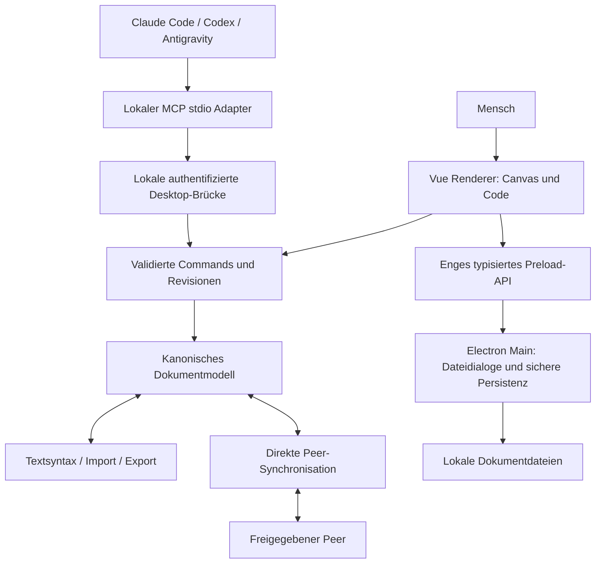

# Sketchdraw — Architektur und Research

Status: Entwurf zur unabhängigen Prüfung, 17.10.2026. Issue: [#6](https://github.com/J-ARTS/de.sketchdraw.io/issues/6), Gesamtziel [#4](https://github.com/J-ARTS/de.sketchdraw.io/issues/4). Dies ist ein Zielentwurf, kein Nachweis einer fertigen Implementierung.

## Produktgrenzen

Alle sechs Fähigkeiten aus AGENTS.md bleiben Teil des Produkts. Das Programm läuft lokal auf Windows, Linux und macOS. Browserausführung dient zusätzlich der Entwicklung und UI-Prüfung. Keine Anmeldung bei einem zentralen Dokumentdienst, kein zentraler Dokumentenspeicher und kein versteckter Signaling-/Relay-Fallback. Die Verbindungsgrenzen dieses Modells müssen in der Oberfläche sichtbar sein.

## Aufbau

Ein TypeScript-Projekt als modularer Monolith reduziert die anfängliche Integrationslast. Electron enthält nur privilegierte Desktop-Funktionen; Vue enthält Darstellung und Interaktion. Das reine Dokumentmodell ist von beiden unabhängig.

| Bereich | Dateien | Verantwortung | Grenze |
| --- | --- | --- | --- |
| Domäne | `src/domain/` | Antigravity | Reines TypeScript, kein DOM, Electron oder Netzwerk |
| Code-Syntax | `src/codec/` | Antigravity | Dokument ↔ menschenlesbarer Text, strukturierte Fehler |
| Interoperabilität | `src/interop/` | Antigravity | Unvertrauenswürdige Eingaben validieren, Verlustbericht |
| Komponenten | `src/catalog/` | Antigravity | Datenbasierte Sets, keine ausführbaren Plugins |
| Renderer | `src/renderer/` | Claude Code | Darstellung/Interaktion, keine Node- oder Dateisystemrechte |
| Desktop | `electron/` | Antigravity | Dialoge, Dateizugriff und geprüfte IPC-Nachrichten |
| Zusammenarbeit | `src/collaboration/` | Antigravity | Direkter Transport, Identität, Rechte, validierte Replikation |
| Agentenzugriff | `src/mcp/` | Antigravity | MCP-Protokoll und begrenzte Befehle, keine beliebige Codeausführung |
| Produktprüfung | `tests/unit/`, `tests/ui/`, `tests/electron/` | Codex + implementierende Agenten | Getrennte Unit-, Browser- und Desktop-Nachweise |
| Betriebsnachweise | `agent-state/`, `tools/` | Codex | Ticket-/Run-/Aufwand-Verknüpfungen, keine Produktdaten |

## Dokument und Commands

`SketchDocument` ist das kanonische persistierbare Modell: Version, stabile Dokument-ID, Titel, Elemente, lokale Assets, Component Sets und Metadaten. Elemente haben stabile IDs, Geometrie, Stil und optionale semantische Eigenschaften. Z-Reihenfolge ist explizit. Container- und Verbindungsreferenzen müssen existieren und dürfen keine Containerzyklen bilden.

Alle Änderungen aus Canvas, Code, Import, Agenten und Peers passieren dieselbe Validierungs- und Command-Schicht. Commands werden atomar angewendet; fehlgeschlagene Validierung lässt das letzte gültige Dokument unverändert. Eine lokale Revisionsnummer unterstützt Compare-and-Set für Agenten und verhindert das Überschreiben zwischenzeitlicher Nutzeränderungen. Drag-Vorschauen sind kurzlebig; Undo fasst eine abgeschlossene Geste als eine Transaktion zusammen.

Verträge werden in `docs/contracts.md` festgelegt, bevor Frontend und Domäne parallel implementiert werden. Änderungen daran benötigen einen dokumentierten Abgleich der betroffenen Agenten. Datenmigrationen dürfen nicht stillschweigend Informationen verwerfen.

## Canvas und Text

SVG ist der erste Renderer: editierbare Vektoren, Text, Pfade und Verbindungen bilden die Produktsemantik direkt ab. Ein Viewport übersetzt Bildschirmkoordinaten in Dokumentkoordinaten. Pan/Zoom verändert nicht die Geometrie. Bei messbaren Engpässen werden Sichtbarkeitsfilter und ein räumlicher Index eingeführt; Canvas/WebGL ist keine unbelegte Vorabpflicht.

Die Live-Recherche in `docs/design-research.md` konkretisiert die Bedienung: eine freie Zeichenfläche, kompakte Werkzeugleiste und optionale Panels für Katalog, Code und Eigenschaften. Die semantische Elementnavigation ist ein eigener zugänglicher Bearbeitungsweg. Panelzustand, Auswahl und ungespeicherter Codeentwurf liegen außerhalb des persistenten Dokumentmodells; Panelwechsel dürfen keine Arbeit verwerfen. Speicherstatus wird aus bestätigten Desktop-Ergebnissen abgeleitet, nicht aus einer bloß gestarteten Speicheranforderung.

Die versionierte Textsyntax muss IDs, Positionen, Stile, Verbindungspunkte, Container, Metadaten und Assetreferenzen ausdrücken. Ein JSON-Textfeld allein erfüllt das gewünschte Mermaid-nahe Bedienkonzept nicht. Der Parser liefert Zeilen-/Spaltenfehler; ungültige Bearbeitung bleibt als Entwurf erhalten. Formatierung ist deterministisch und Git-freundlich. Gleichzeitige Canvas-/Textänderungen brauchen eine sichtbare Konfliktentscheidung oder eine revisionsbasierte Zusammenführung; niemals stiller Last-Writer-Wins-Verlust.

## Cloud-Komponenten und offene Formate

AWS-, Azure-, GCP- und generische Komponenten sind über stabile semantische Typen und erweiterbare JSON-Sets verfügbar. Die App liefert keine ungeprüften Marken-Assets mit: Herkunft und Nutzungsbedingungen der tatsächlich verwendeten Icons werden dokumentiert. Eigene Sets bestehen aus Daten, SVG-Symbolen nach Sanitizing, Metadaten, Dokumentationslinks und deklarativen Widgets; kein eval oder Remote-Script.

draw.io-Import behandelt XML und komprimierte Diagramme, Seiten, Geometrie, Verbindungen und Container. Der Export erhält unterstützte Semantik; unbekannte Attribute werden entweder als Metadaten aufbewahrt oder im Verlustbericht genannt. SVG-Export enthält sichere Vektoren plus versionierte Sketchdraw-Metadaten für den eigenen Roundtrip. Fremdes SVG wird sicher eingelesen; nicht unterstützte Effekte werden als solche angezeigt. Größen-, Dekompressions- und Verschachtelungslimits gehören zu den Tests.

## Strict P2P und IAM

Vorgeschlagener Transport: WebRTC DataChannels mit `iceServers: []`, manuell ausgetauschten vollständigen Offer/Answer-Paketen und expliziter Peer-Bestätigung. Keine STUN-/TURN-/Signaling-Server. LAN, direkte IPv6- und geeignete direkte Netzwerkpfade sind mögliche Einsatzfälle; NAT-/Firewall-Probleme werden nicht durch einen unerwünschten Relay-Dienst kaschiert.

Verschlüsselung allein ist keine Identitätsprüfung. Pairing zeigt Identitäts-/Session-Fingerprints und die Freigabe des Gegenübers. Rollen `owner`, `editor`, `viewer` werden an authentifizierte Sessions gebunden und beim Empfang erzwungen, nicht nur in der UI. Ein Peer kann empfangene Daten auf seinem eigenen Rechner kopieren; Widerruf kann zukünftigen Zugriff beenden, aber keine bereits übergebenen Kopien zurückholen.

Nach Antigravity-Review AG-04 wird ein validiertes Command-Protokoll mit expliziter Sessionautorität des teilnehmenden Owner-Peers verwendet; siehe `docs/decisions/0002-direct-peer-session-order.md`. Der Owner prüft Rollen und Revisionen und bestätigt eine eindeutige Commitfolge. Die bloße Sortierung nach Lamport-Zeit wird nicht als Konvergenzbeweis übernommen. Alte Vorschläge erzeugen einen sichtbaren Konflikt; unbestätigte lokale Arbeit bleibt erhalten. Fällt der Owner aus, stoppen gemeinsame Commits, ohne lokale Entwürfe zu verwerfen. Ein zentral betriebener Server oder Relay wird dadurch nicht eingeführt. Netzwerkfehler, Wiederverbindung, Duplikate, Reihenfolge, konkurrierende Änderungen und lokale Undo-Semantik gehören zur Abnahme.

## MCP und lokale Sicherheit

Ein stdio-MCP-Adapter exponiert Lesen, Suche/Analyse und begrenzte Diagramm-Commands. Der konkrete Vertragsentwurf steht in `docs/contracts-mcp.md` und wird vor S3 mit den Implementierenden abgeglichen. Er verbindet sich mit einer ausschließlich lokalen Desktop-Brücke. Verbindungen brauchen eine lokale Capability, erlaubte Dokumente und `read`/`write`-Rechte. Kein offen erreichbarer HTTP-Dienst, keine beliebigen Shell-/Dateipfad-Tools. Stale Revisionsnummern führen zu einem strukturierten Konflikt, nicht zum Überschreiben.

Diagrammtexte, Imports und Toolresultate sind Daten, keine Agentenanweisungen. Nutzbare Skills beschreiben Ressourcen, Toolverträge, Beispiele und menschlich überprüfbare Änderungsvorschläge. Abnahmetest: ein echter MCP-Client erstellt und verändert ein Diagramm, die UI zeigt dasselbe Dokument und ein Mensch kann das Ergebnis weiterbearbeiten.

Electron lädt lokal gebündelte Inhalte, verwendet `contextIsolation: true`, `sandbox: true`, `nodeIntegration: false`, eine restriktive CSP sowie geprüfte IPC-Sender. Preload bietet benannte Methoden statt rohem IPC. Externe Links nur mit geprüften Protokollen und expliziter Nutzeraktion. Speichern ist atomar mit nachvollziehbaren Fehlern; Überschreiben neuerer Dateiversionen ist ein Konflikt.

## Research-Quellen und offene Nachweise

- [Electron Security](https://www.electronjs.org/docs/latest/tutorial/security): Grundlage der Prozess-/IPC-Grenzen; tatsächlich eingesetzte Konfiguration separat prüfen.
- [Yjs Custom Provider](https://docs.yjs.dev/tutorials/creating-a-custom-provider): geprüfte Alternative; für die erste Sessionentscheidung nach ADR0002 wird ein validiertes Command-Protokoll statt unkontrollierter CRDT-Updates verwendet.
- [RTCPeerConnection-Konfiguration](https://developer.mozilla.org/en-US/docs/Web/API/RTCPeerConnection/RTCPeerConnection): Grundlage der direkten ICE-Konfiguration; keine Zusage allgemeiner Internet-Erreichbarkeit.
- [MCP Server Guide](https://modelcontextprotocol.io/docs/develop/build-server): Protokollintegration; eingesetzte SDK-Version beim Setup erfassen.
- UI-Referenzen und tatsächlich beobachtete Interaktionen werden in `docs/design-research.md` dokumentiert. Einfaches Layout ist eine ausdrückliche Nutzervorgabe, kein automatisch bestätigtes Detaildesign.

## Validierung und Entscheidungsprozess

Jeder materielle Einwand aus Claude Code, Antigravity oder Codex erhält eine ID in `docs/concerns.md`, Quelle, betroffene Anforderungen, Entscheidung und Prüfnachweis. Offene Risiken werden nicht als gelöst dargestellt. Sprints sind Lieferreihenfolge, keine fingierten Kalender-/Aufwandszusagen. Alle Fertigmeldungen hängen an konkreten Unit-, UI-, Peer-, MCP- und Plattformnachweisen aus `docs/sprints.md`.
