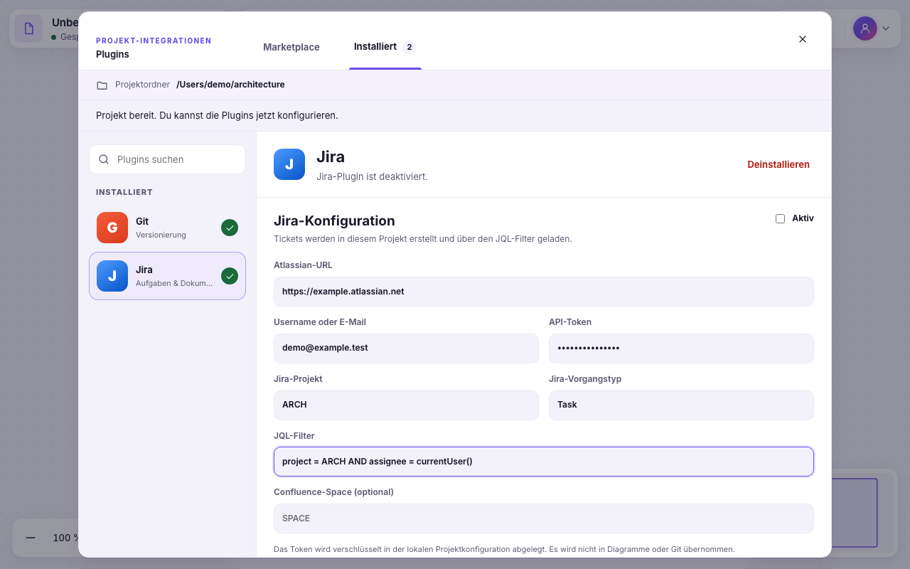
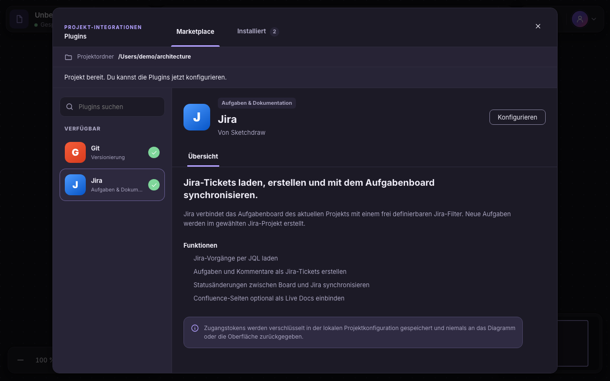

# Plugin-Marketplace: lokale Abnahme #160

Stand: `codex/158-custom-dropdowns` auf Basis `3bd7ab9`, Änderungen für #160 lokal und noch nicht integriert. Geprüfte Quelldateien mit SHA-256 sowie genaue Befehle: [160-local-validation.json](160-local-validation.json).

## Ergebnis

- Kompakter Marketplace mit Übersicht und separatem Installiert-Bereich. Installierte Plugins öffnen direkt ihre Konfiguration. Git/Jira sind in neuen Projektordnern vorinstalliert, zunächst deaktiviert; ausdrückliche frühere Deinstallation bleibt erhalten.
- Speichern-Einstieg bei neuen Diagrammen, sichtbare Fehler/Rückmeldungen, getrennte Git-/Jira-Entwürfe und vollständige Tastaturführung. Responsive Darstellung in beiden Themes.
- Electron-Konfiguration nutzt Plain-DTOs statt Vue-Proxys. Projektkontext wird erst für angenommene lokale Dokumente aktiviert. Neue/Gast-/Importdokumente verlieren vorherige Plugin-Autorität; veraltete Antworten werden ignoriert.
- Atomare Konfigurationsspeicherung vor Aktivierung, keine geheimen Felder im öffentlichen Snapshot, Schutz gegen versehentliche Token-Weitergabe bei geändertem Server/Remote. Bestehende Remote-Git- und Jira-Flows sind nicht durch echte Serverzugänge abgenommen.

## Prüfung

847 Unit-Tests in 99 Dateien, 16 Plugin-UI-Tests, 5 zusätzliche Settings-/Taskboard-UI-Tests und ein nativer Electron-Produktlauf bestanden. Typecheck und Build bestanden. UI-Prüfung umfasst 360/960/1280 px in Hell/Dunkel, axe, gespeicherte Konfigurationen, unabhängige Entwürfe, Fokus, ungültigen DSL-Entwurf und verzögerte Antworten über Projektwechsel. Native Prüfung verwendet den echten gebauten Renderer, Preload, Main, Git und Dateipersistenz; nur das Ergebnis des nativen Dateidialogs wird vorgegeben. Sie prüft Git/Jira-Speicherung, sichtbare IPC-Fehler, Wiederverwendung im Ordner und Isolation zwischen Ordnern.

Die drei zusätzlichen unabhängigen UI-Befunde wurden korrigiert und erneut geprüft. Vorherige Testfehler und die kollidierenden Playwright-Ausgabeverzeichnisse sind im JSON nachvollziehbar festgehalten; nur erfolgreiche Abschlussläufe gelten als Nachweis.

## Sparring und Zuständigkeit

Tatsächliches Claude Code Fable5.2/high-Sparring: [Originalbericht](160-fable-sparring.md), [CLI-Metadaten](160-fable-sparring.json). Es war ein lesender Review, keine Implementierung und kein Testlauf. Die nachgelagerten UI-Implementierungsversuche wurden ohne Dateiänderungen abgebrochen. Codex übernahm die Umsetzung unter bestehender Nutzerautorisierung. Die unterbrochenen Läufe bleiben separat dokumentiert und werden nicht als erfolgreicher Beitrag ausgegeben.

## Grenzen und Fortsetzung

Keine echten Jira/Confluence-Zugangsdaten, kein Remote-Push/Pull, keine Windows/Linux-Ausführung und kein Installer/Release in dieser Aufgabe. #160 bleibt bis zur Main-Integration offen. Unbekannte/beschädigte Konfigurationsdateien vor Überschreiben schützen: separat geplantes [#161](https://github.com/J-ARTS/de.sketchdraw.io/issues/161).

## Ansichten

Graphify: Der vollständige Codegraph-Refresh wurde durch die bekannte Schutzprüfung #145 abgewiesen (6021 statt 6128 Knoten); kein erzwungenes Überschreiben. Die Ticket-/Run-Verknüpfungen wurden erfolgreich erneuert (2488 Knoten, 3371 Links) und mit `--check` validiert. Damit ist die Traceability aktuell; ein vollständig erneuerter Codegraph wird nicht behauptet.
