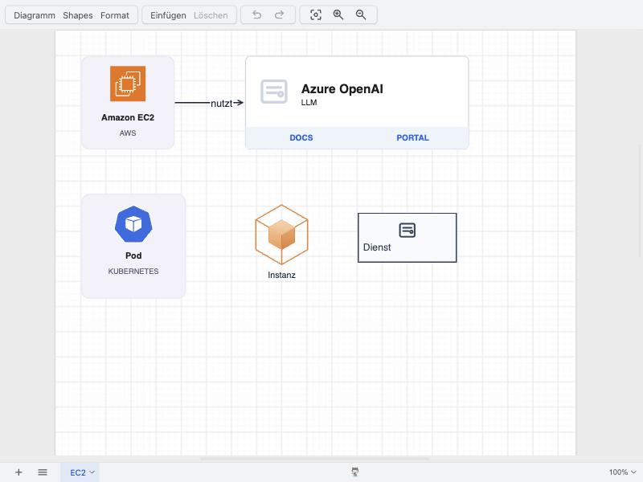

# Sichtprüfung des draw.io-Exports (#260)

22.11.2026, Stand `1fd1e8d`. Geöffnet wurde `tests/fixtures/interop/drawio-export/cards-reference.drawio` im
draw.io-Webeditor (`app.diagrams.net`, Oberfläche „min“, Zoom 100 %) über die Rohdatei des Commits.

Befund:

- EC2-Karte, Kubernetes-Pod und Ressourcenkarte erscheinen als Karte mit Icon, Namen, Anbieter bzw. Beschreibung und
  Link-Leiste, so wie die Zeichenfläche sie zeigt.
- Das isometrische Icon steht mit seinem Text darunter, die generische Komponente mit zentriertem Symbol und Text in
  der unteren Hälfte. Beim ersten Öffnen (Stand `41dc689`) stand der Text der generischen Komponente über dem Symbol;
  das ist mit `1fd1e8d` behoben.
- Der Pfeil hängt an den Bildzellen (Ausgang rechts Mitte, Eingang links Mitte) und trägt seinen Text.

Grenzen dieser Prüfung: Webeditor statt der installierten draw.io-App; Schrift ist die Ersatzschrift des Browsers
(Inter ist in draw.io nicht geladen). Der Text einer Komponente ist Teil des Bildes und in draw.io nicht bearbeitbar;
er steht zusätzlich als verdeckter Wert der Zelle in der Datei.
