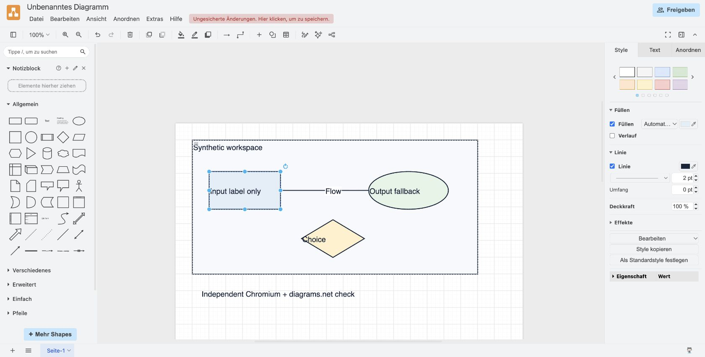
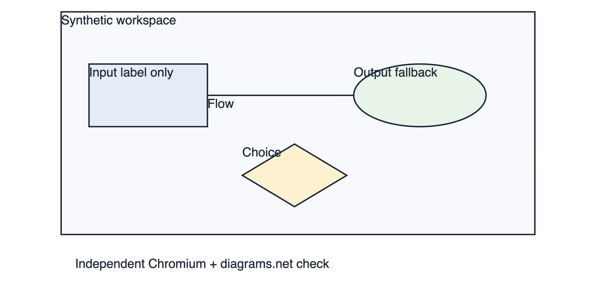

# Echte Interop-Fremdprogrammprüfung — #12/#15

17.10.2026, Codex (`setup_integration`). Ausgangsrevision `f8c55fb2d8250b236aa133609462894a402db40a` plus gezielte lokale Containerkorrektur und Prüfartefakte. Kein neuer Commit, Push oder Release durch diesen Agenten. Umgebung: macOS/Darwin arm64, Node v22.16.0, installierter Google Chrome **155.0.8059.82**, diagrams.net-Weboberfläche laut sichtbarem Hilfe-Menü **v32.5.4**.

## Vorgehen und bestätigte Ergebnisse

`node tests/fixtures/interop/generate-external.mjs` erzeugte ausschließlich eigene synthetische Prüfdaten: Container, Rechteck, Ellipse, Raute, gebundene Verbindung und Text. Export erfolgte mit den echten Funktionen aus `src/interop/`, inklusive eigener Metadaten. Keine Nutzerdatei wurde an einen fremden Dienst übertragen. Der erste Generatorlauf mit Node-Bundling scheiterte an einem dynamischen Bibliotheksimport; browserkompatibles Bundling der bereits browserreinen Adapter beseitigte das Generatorproblem. Keine Produktänderung war dafür nötig.

1. **SVG in echtem Chromium:** Unveränderte `sketchdraw-export.svg` über einen kurzlebigen, nur auf `127.0.0.1` gebundenen lokalen Server geöffnet. Screenshot und DOM bestätigen sechs sichtbare Texte, zwei Rechtecke einschließlich Containerrahmen, eine Ellipse, ein Polygon und eine Verbindung. `viewBox="23 23 714 434"`. Native Beschriftungen sind lesbar, einschließlich `label` ohne `text` und `text:''` mit Label-Fallback.
2. **Export in diagrams.net:** Neuer eigener Prüftab unter `https://app.diagrams.net/`. Den echten `mxGraphModel`-Teil der exportierten Datei über **Extras → Diagramm bearbeiten → Anwenden** geladen. Rechteck, Ellipse, Raute, Verbindung und alle Beschriftungen erscheinen im Fremdprogramm als native bearbeitbare Objekte. Der Root-User-Object-Wrapper mit `sketchdrawInterop` wurde akzeptiert und beim echten Reexport erhalten.
3. **Bearbeitung und echte Datei:** Rechteckbeschriftung in der Oberfläche doppelt angeklickt und zu `Edited in diagrams.net` geändert. Danach **Datei → Exportieren als → XML → Komprimiert → Exportieren → Herunterladen** verwendet. Die echte 2.620-Byte-Datei `diagrams-net-edited.drawio` unverändert aus Downloads übernommen.
4. **Rückimport:** Der Test `external.spec.ts` importiert diese tatsächliche Fremdprogrammdatei. Sechs Elemente, geänderte Beschriftung und beide gebundenen Connectoranker bleiben erhalten. Der alte Text wird nicht wiederhergestellt; eingebettete Zusatzdaten werden wegen geänderter nativer Projektion mit `EMBEDDED_MODEL_STALE` verworfen.

## Gefundener und korrigierter Darstellungsfehler

Die erste echte diagrams.net-Darstellung zeigte **keinen Rahmen und keine Füllung des Containers**: Der Export setzte `group`, und mxGraph zeichnet diesen Gruppentyp unsichtbar. Der Vorherbefund ist in `diagrams-net-loaded.jpg` sowie `sketchdraw-export-before-container-fix.drawio` erhalten. Root hat die gezielte Korrektur ausdrücklich freigegeben.

`src/interop/export.ts` verwendet nun die normale native Rechteckform mit `container=1`; Stroke, Fill, Bounds und Elternbeziehungen bleiben bestehen. `verticalAlign=top` hält die Containerbeschriftung oberhalb der Kindobjekte. Die erste Kontrollansicht ohne diese zusätzliche Ausrichtung setzte den Titel mittig und überlagerte ein Kind; auch das wurde vor dem endgültigen Nachweis korrigiert.

Der tatsächliche korrigierte Export wurde erneut über den sichtbaren XML-Dialog geladen. **Rahmen, Füllung, Titel oben und unveränderte Kindpositionen visuell bestätigt**. Danach erneut mit diagrams.net als komprimierte Datei heruntergeladen (`diagrams-net-container-fixed.drawio`, 2.640 Bytes). Der Rückimport prüft Containerbounds `(40,40,680,320)`, Fill `#f7f9fc`, Stroke `#16243a` und Rechteckposition `(80,115)` mit Containerparent. Eine zusätzliche Regression erzeugt die portable Projektion **ohne** eigene Metadaten und prüft native Styles sowie lokale Kindkoordinaten `(40,75)`.

## Prüfungen und Belege

- `./node_modules/.bin/vitest run tests/unit/interop`: **35/35 bestanden**, drei Dateien, letzter Lauf 16:48:10, 353 ms; keine übersprungenen Tests. Enthält die drei neuen externen Prüfungen und die vorhandenen internen/Root-Regressionen.
- `./node_modules/.bin/tsc --ignoreConfig --noEmit --strict --noUnusedLocals --noUnusedParameters --noUncheckedIndexedAccess --skipLibCheck --target ES2022 --module ESNext --moduleResolution Bundler --lib ES2023,DOM --types node src/interop/*.ts tests/unit/interop/*.spec.ts`: **bestanden**, Exit 0.
- Dateien und Screenshots: `tests/fixtures/interop/external/`; Herkunftstabelle dort in `README.md`.
- SHA-256 des echten ersten Downloads: `5c7f785c668c7f2d1e418cd3894931d67976a8f00b274225f80fff808069ded1`.
- SHA-256 des echten finalen Downloads: `e677a05db4ddd75c1a090b5fe2fb06dfba4c2b93e07423dde21efb86fd198f94`.

## Genaue Grenzen

Der verfügbare In-App-Browser war nicht nutzbar; geprüft wurde der vorhandene echte Chrome über Browsersteuerung. **Datei → Öffnen von → Gerät** erzeugte kein nutzbares Filechooser-Ereignis und keinen sichtbaren nativen Dateidialog. Der XML-Editor war der überprüfte Importweg. Daher wird kein bestandener Dateidialog-/Uploadtest behauptet. Die Beobachtung des Downloadereignisses lief ebenfalls in ein Timeout, obwohl Chrome die gewählten Dateien tatsächlich in Downloads gespeichert hatte; diese Existenz, Inhalte und Hashes wurden danach unabhängig geprüft.

Dies ist eine begrenzte echte Abnahme der genannten sechs Elementarten und eines bearbeiteten Fremdprogrammexports. Sie ersetzt nicht die Gesamtproduktabnahme aller Bilder, Providericons, komplexen Textlayouts, mehrseitigen Dateien, aller Browser-/OS-Kombinationen oder der Electron-Dateidialoge. Schrift-/Labelplatzierung darf gemäß Exportbericht abweichen; getestet wurden sichtbare Daten, Grundgeometrie und Bearbeitbarkeit, keine Pixelgleichheit. Keine pauschale verlustfreie Konvertierung fremder Formate wird behauptet.
